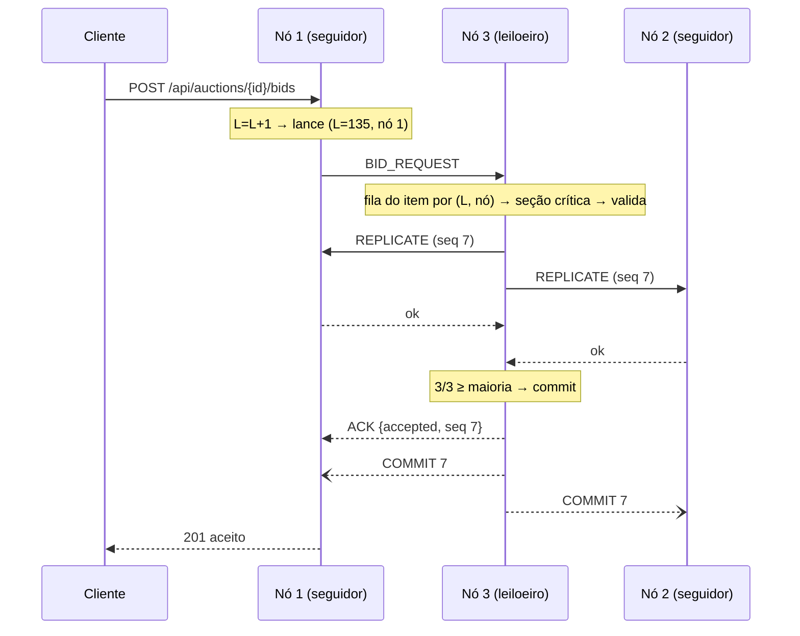
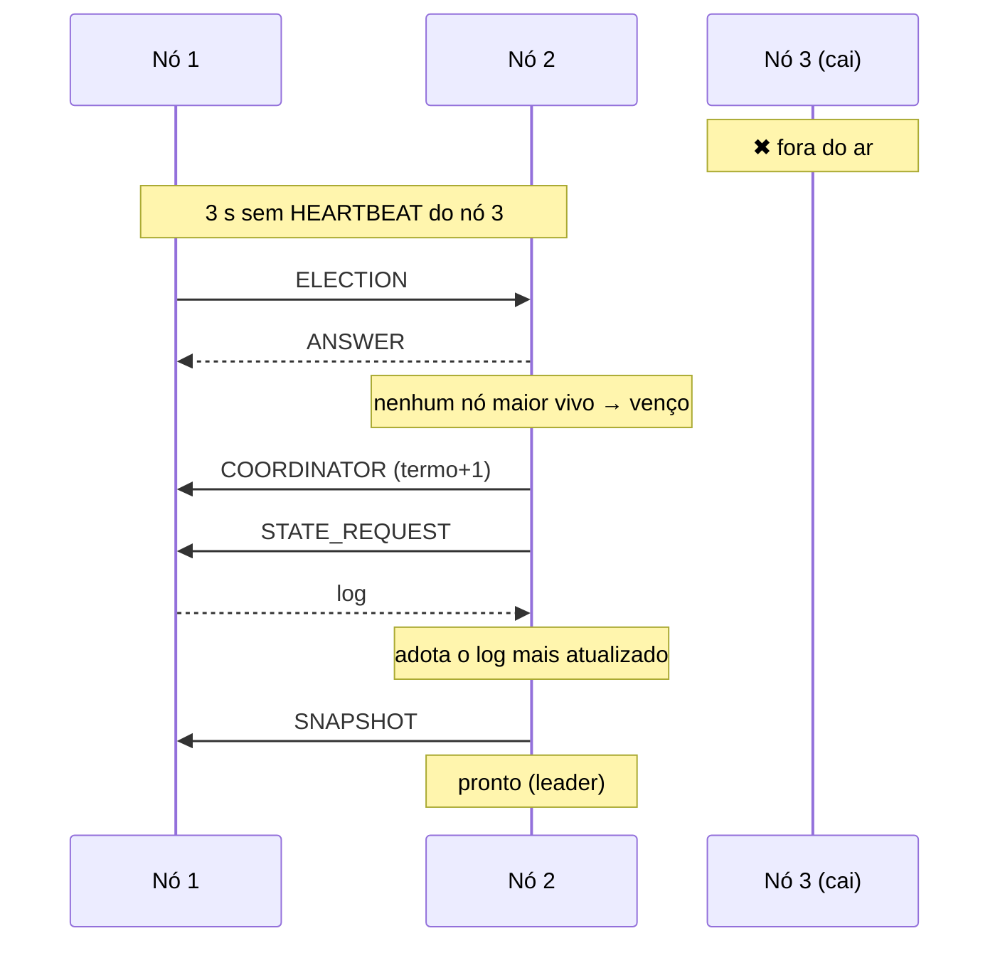

# Protocolo de mensagens — Leilão on-line distribuído

Este documento descreve todas as mensagens trocadas entre os nós e a API usada pelos clientes.

## 1. Transporte

- **Tecnologia:** HTTP/1.1 + JSON (REST), servidor FastAPI e cliente `httpx` assíncrono.
- **Entre nós:** toda mensagem é um `POST /internal/msg` com o **envelope** abaixo. A resposta HTTP 200 traz outro envelope.
- **Porta:** 8000 dentro da rede Docker `leilao-net`.
- **Timeout padrão:** 1 s (`RPC_TIMEOUT`). Se o nó não responde dentro do tempo, a mensagem é tratada como perdida. O detector de falhas não conta esse contato.

## 2. Envelope

Requisição (de um nó para outro):

```json
{
  "type": "HEARTBEAT",
  "sender": 2,
  "term": 4,
  "lamport": 117,
  "payload": { }
}
```

| Campo | Tipo | Significado |
|---|---|---|
| `type` | string | Tipo da mensagem (seção 4) |
| `sender` | int | ID do nó remetente |
| `term` | int | Maior termo (mandato de líder) que o remetente conhece |
| `lamport` | int | Relógio de Lamport do remetente **após** incrementar para o envio |
| `payload` | objeto | Conteúdo específico do tipo |

Resposta: mesmo formato, com `type = "ACK"` (ou `"ANSWER"` quando a requisição é `ELECTION`, ou `"ERROR"` para tipo desconhecido).

### Regras aplicadas a toda mensagem

1. **Lamport no envio:** `L = L + 1`, e o envelope leva `L`.
2. **Lamport no recebimento** (de requisição ou resposta): `L = max(L, lamport_recebido) + 1`.
3. **Detector de falhas:** qualquer mensagem ou resposta recebida de `sender` atualiza `last_seen[sender]`.
4. **Termo:** se `term` recebido é maior que o meu, adoto esse termo; se eu era líder, deixo de ser. A exceção são `HEARTBEAT` e `COORDINATOR`, que têm regras próprias (seção 4).

## 3. Descoberta de serviços

Nenhum endereço é fixo no código. Todos os contêineres entram na rede `leilao-net` com o **alias DNS** `leilao-cluster`:

1. A cada 2 s (`DISCOVERY_INTERVAL`), o nó resolve `leilao-cluster` no DNS interno do Docker e recebe a lista de IPs dos contêineres vivos.
2. Para cada IP novo (ou de um nó considerado fora do ar), envia `HELLO`.
3. A resposta traz o `node_id`. Se for o próprio ID, o IP é marcado como "eu"; senão o vizinho entra na tabela `peers`.

Assim, `docker compose --profile extra up node4` adiciona um nó que é encontrado sozinho.

## 4. Tipos de mensagem entre nós

### 4.1 `HELLO` — descoberta

| | Conteúdo |
|---|---|
| payload | `{"public_url": "http://localhost:8001"}` |
| resposta | `{"node_id": 3, "public_url": "http://localhost:8003", "leader_id": 3, "term": 2}` |

### 4.2 `HEARTBEAT` — detecção de falhas e sincronização

Enviado por **todo nó para todo vizinho** a cada 1 s (`HEARTBEAT_INTERVAL`). Um vizinho sem contato há mais de 3 s (`FAILURE_TIMEOUT`) é considerado **fora do ar**.

| | Conteúdo |
|---|---|
| payload | `{"role": "leader", "leader_id": 3, "commit_seq": 12}` |
| resposta | `{"last_seq": 12, "last_id": "9f2c…", "commit_seq": 12, "synced_term": 2}` |

- `role` ∈ `follower`, `recovering`, `leader`.
- Se o remetente se declara líder (`role` = leader/recovering e `leader_id == sender`):
  - um seguidor passa a segui-lo se o termo for maior, ou igual com ID maior que o líder atual;
  - um líder desce se `(term, sender) > (meu_term, meu_id)`;
  - se o remetente tem **ID menor** que o meu, inicio uma eleição Bully (vou tomar a liderança).
- Se o líder que eu seguia manda heartbeat dizendo que não é líder, esqueço o líder.
- O seguidor aplica `commit_seq` do líder se o seu log já foi verificado por ele (`synced_term == term`).
- **Líder:** compara `last_seq`/`last_id`/`synced_term` da resposta com o próprio log. Se o seguidor estiver atrasado ou divergente, envia `SNAPSHOT`.

### 4.3 `ELECTION` / `ANSWER` — algoritmo Bully

| | Conteúdo |
|---|---|
| payload | `{}` |
| resposta | envelope com `type = "ANSWER"`, payload `{"alive": true}` |

- Enviado por um candidato para **todos os nós com ID maior**.
- Quem recebe responde `ANSWER` e inicia sua própria eleição. Se já for o líder, reenvia `COORDINATOR` para todos, sem criar termo novo.
- Se nenhum nó maior responde em 1,5 s (`ELECTION_TIMEOUT`), o candidato vence.
- Um nó recém-iniciado (ou religado) só inicia eleição depois de `STARTUP_GRACE` (3 s), para antes descobrir os vizinhos e ouvir se já existe líder. O novo líder também refaz a descoberta antes de recuperar o log.
- Se algum respondeu, o candidato espera `COORDINATOR` por 4 s (`COORDINATOR_TIMEOUT`); se não chegar, recomeça.

### 4.4 `COORDINATOR` — anúncio do novo leiloeiro

| | Conteúdo |
|---|---|
| payload | `{"leader_id": 3}` (o termo novo vai no envelope) |
| resposta | `{"accepted": true}` ou `{"accepted": false, "reason": "..."}` |

O vencedor usa `term = maior termo conhecido + 1`. O receptor **recusa** se:

- o termo é menor que o seu;
- o remetente tem ID menor que o receptor (o receptor então começa uma eleição e assume);
- empate de termo e o receptor já segue um líder vivo de ID maior.

### 4.5 `BID_REQUEST` — lance encaminhado ao leiloeiro (pedido do mutex)

Um nó que recebe um lance de um cliente carimba o timestamp de Lamport e encaminha ao líder. Para a exclusão mútua, esta mensagem é o **REQUEST** do algoritmo centralizado. A resposta faz o papel de **GRANT + RELEASE**: o líder executa a seção crítica e responde ao final.

Payload (o lance):

```json
{
  "id": "4b1f0c9e2a7d",
  "auction_id": "a1e344906f9d",
  "bidder": "Felipe",
  "amount": 1550.0,
  "node_id": 1,
  "lamport": 135,
  "received_at": 1795037544.93
}
```

Respostas possíveis:

| Situação | payload |
|---|---|
| aceito e confirmado pela maioria | `{"accepted": true, "bid": {…, "seq": 7}}` |
| reenvio de lance já aceito | `{"accepted": true, "bid": {…}, "duplicate": true}` |
| inválido | `{"accepted": false, "reason": "lance abaixo do mínimo (mínimo atual: R$ 1600.00)", "bid": {…}}` |
| sem maioria | `{"accepted": false, "reason": "sem quórum: 1 de 2 confirmações necessárias"}` |
| não sou líder | `{"error": "not_leader", "leader_id": 2}` |
| líder ainda sincronizando | `{"error": "not_ready"}` |

Ao receber `error` ou nenhuma resposta, o nó de origem espera 0,3 s e tenta de novo com o líder atual, por até 8 s (`FORWARD_TIMEOUT`). O campo `id` garante que o reenvio não duplica o lance.

**Seção crítica no líder (por item):**

1. Entra na fila de prioridade do item com chave `(lamport, node_id)`.
2. Espera a janela de *hold-back* (150 ms) e a liberação do item.
3. Valida o lance contra o estado confirmado: leilão aberto, prazo não vencido, `amount ≥ maior + incremento` (ou `≥ preço inicial`).
4. Replica com `REPLICATE` e espera a maioria.
5. Libera o item para o próximo da fila.

### 4.6 `CREATE_REQUEST` — criação de leilão encaminhada ao leiloeiro

Payload: `{"id", "title", "description", "start_price", "min_increment", "duration_s", "created_by_node", "lamport"}`.
O líder define `ends_at = agora + duration_s` e replica. Resposta: `{"created": true, "auction": {…}}`, ou os mesmos erros de `BID_REQUEST`.

### 4.7 `REPLICATE` — replicação de uma entrada do log (líder → seguidor)

```json
{
  "entry": {
    "seq": 7, "term": 2, "id": "c23e2d23e8aa",
    "kind": "BID", "data": { "...lance..." },
    "lamport": 133, "leader": 3
  },
  "prev_id": "9f2c11ab03de",
  "commit_seq": 6
}
```

`kind` ∈ `CREATE_AUCTION`, `BID`, `CLOSE`.

O seguidor:

- recusa com `{"ok": false, "stale_term": true}` se o termo do envelope é menor que o seu;
- recusa com `{"ok": false, "ahead": true}` se a entrada substituiria uma entrada que ele já **confirmou**. O líder, ao receber `ahead`, refaz a recuperação (STATE_REQUEST) e adota o log mais completo. Isso protege contra um líder que voltou com memória vazia;
- recusa com `{"ok": false, "need_snapshot": true}` se não tem a entrada `seq-1` com id `prev_id` (log atrasado ou divergente);
- caso contrário, descarta qualquer entrada a partir de `seq` (restos não confirmados de um líder antigo), grava a nova, aplica `commit_seq` e responde `{"ok": true}`.

O líder conta as respostas `ok` (mais ele mesmo). Com `acks ≥ quórum` (maioria por padrão), a entrada é **confirmada**; senão é desfeita e a operação falha com "sem quórum".

### 4.8 `COMMIT` — aviso de confirmação (líder → seguidores)

Payload `{"commit_seq": 7}`. Enviado logo após a maioria confirmar, para os seguidores aplicarem a entrada sem esperar o próximo heartbeat. Resposta `{"commit_seq": 7}`.

### 4.9 `SNAPSHOT` — log completo (líder → seguidor)

Payload `{"entries": [ ... ], "commit_seq": 7}`. O seguidor troca o log pelo do líder, a menos que o snapshot seja prefixo do log que ele já tem. Se o snapshot não contém todas as suas entradas confirmadas, ele recusa com `{"ok": false, "ahead": true}` (mesma regra do REPLICATE): uma entrada confirmada nunca volta a ser não confirmada. Depois reconstrói o estado do leilão a partir das entradas confirmadas. Resposta `{"ok": true, "changed": true|false}`.

Usado quando:

- o seguidor pede (`need_snapshot`);
- o heartbeat mostra que ele está atrasado (por exemplo, um nó que voltou);
- o novo líder termina a recuperação.

### 4.10 `STATE_REQUEST` — recuperação após eleição

Enviado pelo novo líder a todos os vivos. Resposta: `{"entries": [...], "commit_seq": 7, "last_term": 2, "last_seq": 7}`.
O líder adota o log com maior `(last_term, last_seq)`. Toda entrada confirmada está numa maioria de nós, então algum nó vivo a possui. Em seguida o líder confirma esse log e envia `SNAPSHOT` a todos. Só então passa de `recovering` para `leader` e começa a aceitar lances.

### 4.11 `STATUS` — observabilidade

Payload `{}`. Resposta: papel, líder, termo, Lamport, `last_seq`, `commit_seq`, hash do log confirmado, visão dos vizinhos, fila do mutex (se líder) e últimos eventos. Usado pelo painel (`/dashboard`).

## 5. Fluxos principais

### Lance recebido por um seguidor



### Queda do leiloeiro



## 6. API dos clientes (porta pública de cada nó)

Qualquer nó atende. Leituras vêm do estado confirmado local; escritas são encaminhadas ao leiloeiro.

| Método e rota | Corpo | Resposta |
|---|---|---|
| `GET /api/auctions` | — | `{"node_id", "commit_seq", "auctions": [resumo…]}` |
| `GET /api/auctions/{id}` | — | resumo + `bids` (ordem do log) |
| `POST /api/auctions` | `{"title", "description?", "start_price", "min_increment", "duration_s"}` | 201 `{"created": true, "auction"}` |
| `POST /api/auctions/{id}/bids` | `{"bidder", "amount", "request_id?"}` | 201 aceito, 409 recusado, 503 sem leiloeiro |
| `GET /api/cluster` | — | líder, termo, lista de nós com `public_url` (usada para failover) |
| `GET /api/cluster/status` | — | `STATUS` de todos os nós (painel) |
| `GET /api/node` | — | `STATUS` só deste nó |
| `GET /`, `GET /cliente`, `GET /dashboard` | — | modo apresentação, cliente simples e painel técnico |

### Administração (só para a demonstração)

| Método e rota | Corpo | Efeito |
|---|---|---|
| `POST /api/admin/crash` | — | Falha simulada: o nó para de enviar mensagens; `/internal/msg` e a API pública respondem 503 (cabeçalho `X-Node-Crashed: 1`). |
| `POST /api/admin/restart` | — | Religa o nó com memória vazia (log, termo, relógio, vizinhos), como um processo novo. |
| `POST /api/admin/speed` | `{"slow": true\|false}` | Câmera lenta: seção crítica de 1,2 s e janela do mutex de 0,5 s. |

O `STATUS` também traz `messages` (últimas mensagens enviadas: tipo, destino, Lamport, se chegou), `log_tail` (últimas entradas confirmadas) e eventos com `code` estruturado, usados pelo modo apresentação para animar e narrar.

Resumo de um leilão: `id, title, start_price, min_increment, ends_at, remaining_s, status (open|closed), highest_bid, bid_count, min_next_bid, winner`.

## 7. Parâmetros (variáveis de ambiente)

| Variável | Padrão | Uso |
|---|---|---|
| `NODE_ID` | — | ID do nó (Bully: maior vence) |
| `DISCOVERY_HOSTS` | `leilao-cluster` | nome(s) DNS resolvidos para achar vizinhos |
| `PUBLIC_URL` | `http://localhost:8000` | endereço para navegadores |
| `HEARTBEAT_INTERVAL` | 1.0 s | período do heartbeat |
| `FAILURE_TIMEOUT` | 3.0 s | sem contato → fora do ar |
| `ELECTION_TIMEOUT` | 1.5 s | espera por `ANSWER` |
| `COORDINATOR_TIMEOUT` | 4.0 s | espera por `COORDINATOR` |
| `MUTEX_HOLDBACK` | 0.15 s | janela de ordenação por Lamport |
| `CS_DELAY` | 0.25 s | tempo simulado na seção crítica |
| `WRITE_QUORUM` | `majority` | confirmações para commit (ou um número) |
| `FORWARD_TIMEOUT` | 8.0 s | insistência ao encaminhar ao líder |
